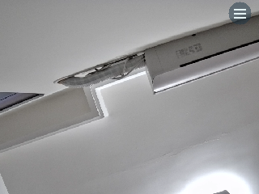
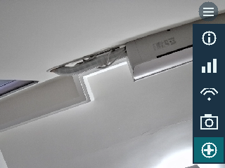
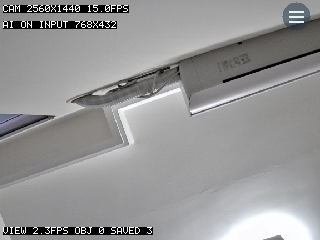
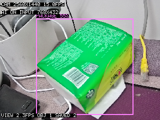
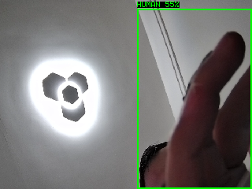
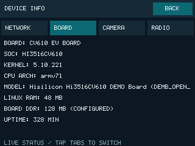
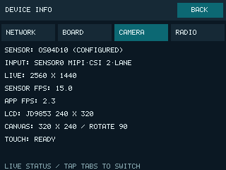
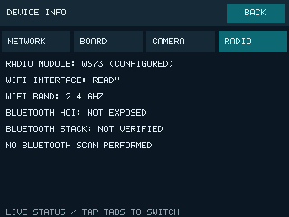

# CV610 Camera AI LCD

Hi3516CV610 独立应用：OS04D10 摄像头实时采集、AIComponent 多目标检测、JD9853 横屏显示、触屏 Wi-Fi 配网与截图下载。

本项目可放在任意目录独立构建，**不需要放入官方 samples，也不依赖相邻 sample 源码**。必需的海思初始化辅助代码已包含于 `vendor/hisilicon/comm/`；海思 SDK、模型、工具链、ARM libdrm 及板端驱动仍为外部依赖，不随仓库分发。

## 目录

- [功能](#功能)
- [运行截图](#运行截图)
- [硬件与运行环境](#硬件与运行环境)
- [Ubuntu 构建](#ubuntu-构建)
- [Wi-Fi 与截图服务打包](#wi-fi-与截图服务打包)
- [安装与启动](#安装与启动)
- [屏幕操作](#屏幕操作)
- [截图下载](#截图下载)
- [验证记录与测试](#验证记录与测试)
- [目录结构](#目录结构)
- [常见问题](#常见问题)
- [来源与许可](#来源与许可)

## 功能

```text
OS04D10 → VI / ISP → VPSS NV21 → AIComponent → 画面 + 多目标框 / 类别 / 置信度
                                                          ↓
                                                JD9853 LCD + 触摸菜单
```

- 采集 2560×1440 / 15 FPS，VPSS 输出 768×432；逻辑横屏 320×240，整体旋转 90°。
- 等比铺满屏幕并居中裁剪；图像和识别框采用同一变换。
- `--models hvf`：人脸、人体、车辆；`--models all` 加入宠物、包裹。使用 SDK 专用模型，不支持任意物体或人名识别。
- 多目标同帧识别与绘制；默认开启 AI，可通过菜单关闭推理，仅保留预览。
- 默认直接进入预览，后台重连保存的 Wi-Fi；触屏扫描热点、选择网络、输入密码，无须手机 BLE。
- 网络、主板、摄像头、无线模块信息；画面统计开关；PNG / JSON 截图；只读 FTP 和 HTTP 相册。
- 未实现连续录屏、RTSP、异步推理或永久安装内核。

## 运行截图

以下是 2026-11-03 自动触摸操作后，从实板 DRM framebuffer 读取的真实 320×240 页面，不是界面设计图或屏幕实拍；所选图片不含露脸人物。

| 全屏主界面 | 悬浮菜单展开 | 画面统计开启 |
| --- | --- | --- |
|  |  |  |

上图是实际摄像头预览，截图时画面中无检测目标；统计显示采集 2560×1440 / 15 FPS、AI 输入 768×432，应用约 2.3 FPS。菜单和统计页由完整 framebuffer 采集，区别于菜单中相机按钮保存的纯摄像头与识别结果图。

包裹识别截图 `shot-19211-22666-000003.png`：模型将画面中的绿色纸盒标为 PACKAGE，置信度 55%，识别框、类别与置信度均为原图内容。



用户保留的识别截图 `shot-3961-6876-000003.png`：



该帧实际标签为 HUMAN、置信度 55%，画面中的手部被标为人体，属于误检示例；不能据此说明 PACKAGE 检测成功。

| 主板信息 | 摄像头与屏幕 | 无线模块 |
| --- | --- | --- |
|  |  |  |

摄像头页显示 OS04D10、2560×1440、15 FPS 采集，AI 开启时应用约 2.3 FPS。RADIO 页的 HCI NOT EXPOSED 表示本应用未验证蓝牙协议栈，不能据此判定硬件损坏。

待补实物照片清单见 [PHOTO_CHECKLIST.md](docs/PHOTO_CHECKLIST.md)。人物露脸原图与未检查截图不纳入文档。

## 硬件与运行环境

| 项目 | 要求 |
| --- | --- |
| 主板 | Sunniwell CV610 / Hi3516CV610 |
| 摄像头 | OS04D10，MIPI-CSI 2-Lane，接 Sensor0 |
| 拨码 | SW1301：1-OFF、2-OFF；断电接线和调整 |
| 屏幕 | JD9853 240×320，Hynitron 触摸 |
| 无线 | WS73；2.4 GHz 开放网络或 WPA/WPA2-PSK |
| 构建机 | Ubuntu x86_64；实测 26.04.1 LTS / Python 3.14.4 |
| 板端 | 匹配的 Linux、设备树、MPP、LCD、触摸及 WS73 模块；sdk_server 已运行 |

Mac 可管理源码、运行通用主机测试；SDK 附带的 Linux x86_64 工具链不能直接在 macOS 执行，ARM 程序需在 Ubuntu 交叉编译。

板端先确认 `/dev/dri/card0`、触摸 evdev、`/run/sdk_server/osal_uds_server.sock` 存在。仅安装应用不会自动获得屏幕或 Wi-Fi 驱动。不要同时运行其他 VI / VPSS / NPU / LCD 示例。

本次实板通过 RAM 临时启动 Linux **5.10.221**，配有同步重建的 MPP、屏幕及触摸模块；NAND 内核未更新，断电后需重新准备匹配的运行环境。旧 **5.10.221+** 模块不能与其混用。蓝牙项只报告 HCI 暴露状态，本应用未启用 BLE。

## Ubuntu 构建

先按[官方首个项目教程](https://docs.hisilicon.com/projects/hi_aiot_solution/master/get-started/first-project/index.html)准备完整多仓源码、SDK、解压后的工具链及模型。另需已成功构建 JD9853 panel 示例以取得 ARM libdrm。

```bash
sudo apt update
sudo apt install -y build-essential cmake python3 python3-serial git

git clone https://github.com/kirovl/hisi-sample.git
cd hisi-sample
APP="$PWD"
PROJECT="$HOME/workspace/hi_aiot_solution_cv610_ev_board/sdk_workspace/hi_aiot_solution"
SDK="$PROJECT/sdk/Hi3516CV610"
# 替换成已成功构建 JD9853 panel 示例的完整工程路径
PANEL_PROJECT="$HOME/workspace/cv610-panel/sdk_workspace/hi_aiot_solution"
DRM_PREFIX="$PANEL_PROJECT/_build/open_source/drm/release"
OUT="$HOME/workspace/camera-ai-lcd-output"

test -f "$DRM_PREFIX/lib/libdrm.a"
bash "$APP/build-ubuntu.sh" "$SDK" "$DRM_PREFIX" "$OUT"
file "$OUT/build/camera_ai_lcd" "$OUT/build/wifi_setup"
(cd "$OUT/package" && sha256sum -c SHA256SUMS)
```

`file` 应显示 ARM EABI5，不能是 Ubuntu x86-64。产物为 `build/camera_ai_lcd`、`build/wifi_setup`、`package/` 和 `camera-ai-lcd.tar.gz`。模型及运行库由脚本从 SDK 复制到安装包，输出目录不要放进 SDK 库目录。

最小构建会生成预览与配网程序，但不自带所有可选 Wi-Fi、驱动、服务运行文件；这些需要按下节准备。构建应用不会清理官方工程，也不会烧写或重启开发板。

## Wi-Fi 与截图服务打包

```bash
python3 "$APP/build-services-ubuntu.py" "$SDK" "$OUT/services"
# 替换为已准备好的、与板端内核匹配的官方 WS73 rootfs 暂存目录
WS73_ROOTFS="$HOME/workspace/ws73-rootfs"
python3 "$APP/wifi-provision/package-runtime.py" "$WS73_ROOTFS" "$OUT/wifi-runtime"

WIFI_RUNTIME="$OUT/wifi-runtime" SERVICE_BUILD="$OUT/services" \
  bash "$APP/build-ubuntu.sh" "$SDK" "$DRM_PREFIX" "$OUT"
```

`WS73_ROOTFS` 为输入路径，不是仓库自动提供的文件。所需结构包含 `root/plat_soc.ko`、`root/wifi_soc.ko`、`drv/ko/ot_board_io_cfg.ko`、`root/wpa_supplicant`、`root/wpa_cli`、`lib/libsecurec.so` 与 `ws73/` 固件。打包脚本核对文件和模块内核版本，生成空初始 Wi-Fi 配置，不包含个人密码。

也可通过 `wifi-provision/build-userspace.sh PROJECT OUTPUT` 从 SDK 构建 OpenSSL / libnl / supplicant。板端仍需要适配的 WS73 内核模块，用户态程序不能解决驱动版本不匹配。

内核辅助脚本 `build-wifi-display-kernel.sh PANEL_PROJECT SDK OUTPUT` 基于已有成功 panel 工程，清除额外 `+` 并启用 WIRELESS / CFG80211 / MAC80211，同步重建 MPP、LCD、触摸模块，保留 panel 设备树；仅生成产物，不烧写。它依赖完整 SDK 和已配置的 panel 构建树，建议先 RAM 验证。

## 安装与启动

板端先启动到 Linux，Debug USB 接 Ubuntu，退出其他串口工具并停止旧预览。两端网络应互通，按实际情况替换 IP 和串口路径。

```bash
SERIAL_PORT=/dev/serial/by-id/usb-1a86_USB_Single_Serial_5CF9102052-if00
BOARD_IP=192.168.3.70
ping -c 3 "$BOARD_IP"
sudo python3 "$APP/install-ubuntu.py" "$OUT/camera-ai-lcd.tar.gz" \
  --board-ip "$BOARD_IP" --port "$SERIAL_PORT"
```

安装器通过 TCP 18889 传包，串口只发送命令；校验包及逐文件 SHA256 后安装到 `/opt/camera_ai_lcd`。不会替换内核或设置开机自启，更新前需自行停止旧进程。

在板端 shell 执行：

```sh
sh /opt/camera_ai_lcd/start-application.sh
```

入口直接预览，后台启动 WS73、重连已保存网络，取得 IP 后启动截图服务。`CAMERA_AI_SKIP_WIFI=1` 可跳过后台 Wi-Fi 管理。`Ctrl+C` / SIGTERM 退出并释放相机、模型和显示资源。

单独调试：

```sh
sh /opt/camera_ai_lcd/run.sh --models hvf --seconds 10
sh /opt/camera_ai_lcd/run.sh --headless --models all --frames 10
```

开发期间实板验证副本使用 `/opt/camera_ai_wifi_test`，与标准安装目录不同；不要同时启动两份应用。

## 屏幕操作

右上角固定半透明按钮；点击后向下展开五个图标，不支持拖动。点击菜单外收起。

1. 圆圈 i：设备信息，NETWORK / BOARD / CAMERA / RADIO 页签，BACK 返回。
2. 柱状图：开关画面统计，显示摄像头分辨率、采集 FPS、VIEW FPS、AI ON/OFF、目标及截图数。
3. Wi-Fi：扫描、上下滑动列表、选择热点、输入密码连接；已连接热点标绿。
4. 相机：保存摄像头画面、框与标签；截图不包含导航菜单或设备信息页。
5. AI：开启/关闭推理，开启高亮。关闭后清空旧框，继续预览；切换时重置模式 FPS 统计。

Wi-Fi BACK 随时返回预览，已有连接由后台维持。当前不支持企业认证、WEP 或仅 SAE 的 WPA3；中文 SSID 显示有限制。密码保存于板端配置，设备信息不会显示密码。

## 截图下载

截图保存于 `/opt/camera_ai_lcd/screenshots/shot-*.png` 及同名 JSON。PNG 为逻辑横屏 320×240；统计开启时也会保存统计，菜单始终不保存。SIGUSR1 也可触发截图。

完整包会后台启动服务，也可手动执行：

```sh
sh /opt/camera_ai_lcd/serve-screenshots.sh start
# 停止：sh /opt/camera_ai_lcd/serve-screenshots.sh stop
```

以板端 Wi-Fi `192.168.3.70` 为例：

- 浏览器相册：<http://192.168.3.70:8080/>。
- 只读 FTP：`ftp://192.168.3.70:80/`，匿名，用 FileZilla 或 curl。

**端口 80 是 FTP，HTTP 相册使用 8080。** 普通浏览器不能通过 HTTP 80 查看 FTP。服务不支持上传、删除、TLS 或 SFTP。服务日志位于 `service-runtime/`，抓图不会删除已有文件。

```bash
curl --fail --user anonymous: --list-only ftp://192.168.3.70:80/
```

## 验证记录与测试

2026-11-03：独立源码在 SDK 树外的新临时目录完成全量编译、链接及打包，生成两个 ARM / musl 程序，117 个安装文件 SHA256 全部通过。构建规则没有相邻 `capture_picture/comm` 或 SDK `samples/mpp/common` 路径。详见 [VALIDATION.md](VALIDATION.md)。

同日实板触摸菜单对比：

| 模式 | 实测应用 FPS |
| --- | ---: |
| AI 开启，三模型 | 2.30 |
| AI 关闭 | 11.61 |

摄像头仍为 15 FPS。当前同步推理占主要耗时，关闭后约提升 5 倍。关闭只跳过推理，模型仍驻留。现场确认 FACE、HUMAN、PACKAGE；PET/VEHICLE 尚未现场验证，离线模型测试不等于现场准确率。

通用测试可在 Mac / Ubuntu 执行：

```bash
cc -std=c99 -O2 -I include tests/test_menu.c src/menu.c src/overlay.c -lm -o /tmp/cv610-test-menu
/tmp/cv610-test-menu
cc -std=c99 -O2 -I include tests/test_overlay.c src/overlay.c -lm -o /tmp/cv610-test-overlay
/tmp/cv610-test-overlay
python3 -m unittest discover -s tests -p 'test_*.py'
```

`test_touch.c` 使用 Linux evdev，需要 Ubuntu；`tests/board_smoke.py` 需要开发板、SDK 测试素材和运行环境，属于实板测试。历史照片、原始日志与个人截图不随代码提交。

## 目录结构

```text
src/                     相机、推理、DRM、触摸、菜单、Wi-Fi、截图
include/                 应用接口
vendor/hisilicon/comm/    随项目提供的初始化辅助源码
wifi-provision/          WS73、网络重连、用户态构建及运行包
build-ubuntu.sh          独立 CMake 构建和基础打包
build-services-ubuntu.py  独立 BusyBox FTP/HTTP 构建
install-ubuntu.py         网络安装与校验
start-application.sh     预览和后台 Wi-Fi 入口
gallery/                 截图相册
tests/                  主机与实板验证
```

## 常见问题

| 现象 | 处理 |
| --- | --- |
| 构建时缺少 SDK 或 libdrm | 核对外部路径与 ARM 版本；先完成官方 SDK 和 panel 构建 |
| undefined reference: ot_ivs_md_* | 保留 CMake 中显式链接的 ss_ivs_md |
| Ubuntu 执行 ARM 程序报 Exec format error | 构建产物应在开发板运行 |
| invalid module format | 核对完整内核版本，末尾 `+` 也必须一致 |
| 无 /dev/dri/card0 | 检查显示内核、设备树和模块，安装应用不能代替驱动适配 |
| 摄像头 I2C 首寄存器写失败 | 断电检查 OS04D10 FPC、Sensor0、两个 OFF |
| scan failed | 检查 WS73 模块、CFG80211、supplicant 及版本 |
| 串口 Resource busy | 停止其他串口会话后再安装 |
| 有 Wi-Fi IP 却网络不通 | 检查同网段无链路 eth0 是否抢占回程路由 |
| 相册打不开 | 核对实际 IP、HTTP 8080 和服务日志 |

## 来源与许可

海思辅助源码来自 [HiSpark CV610 仓库](https://gitcode.com/HiSpark/hi_aiot_solution_cv610_ev_board) 的 `samples/capture_picture/comm`，保留 HiSilicon 版权与 Apache-2.0 声明，见 [vendor/hisilicon/README.md](vendor/hisilicon/README.md)。带 Apache-2.0 标注的源码遵循 [Apache License 2.0](LICENSE)。外部 SDK 库、模型、固件和驱动分别遵循其原许可，不包含于本仓库。

截图服务可选构建的 BusyBox 遵循其自身许可；构建器在运行包中保留许可证及配置，对应源码来自 SDK 的 busybox-1.34.1。分发服务二进制时应同时满足其源码提供要求。
